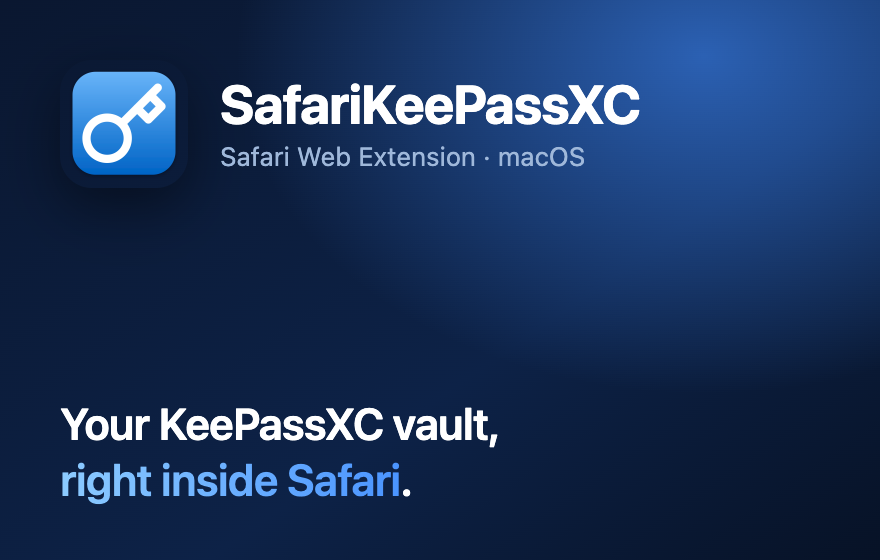
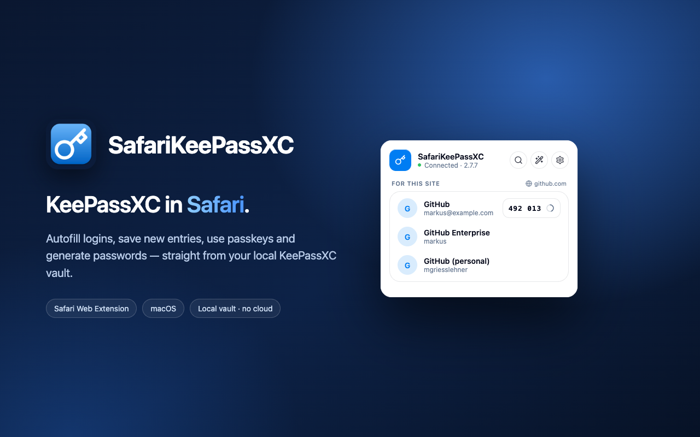
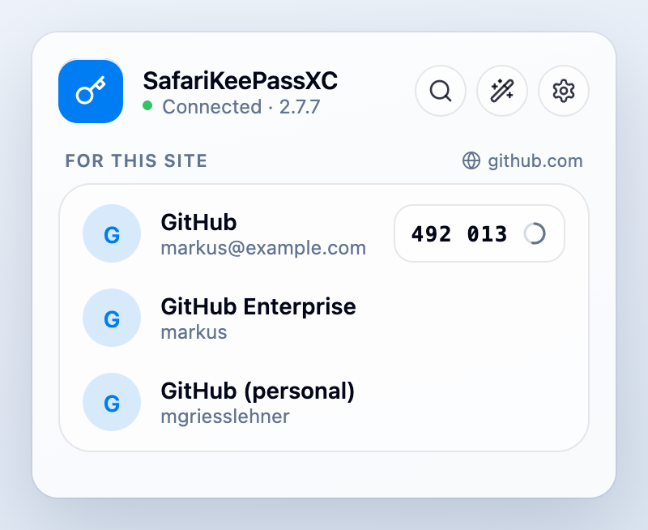
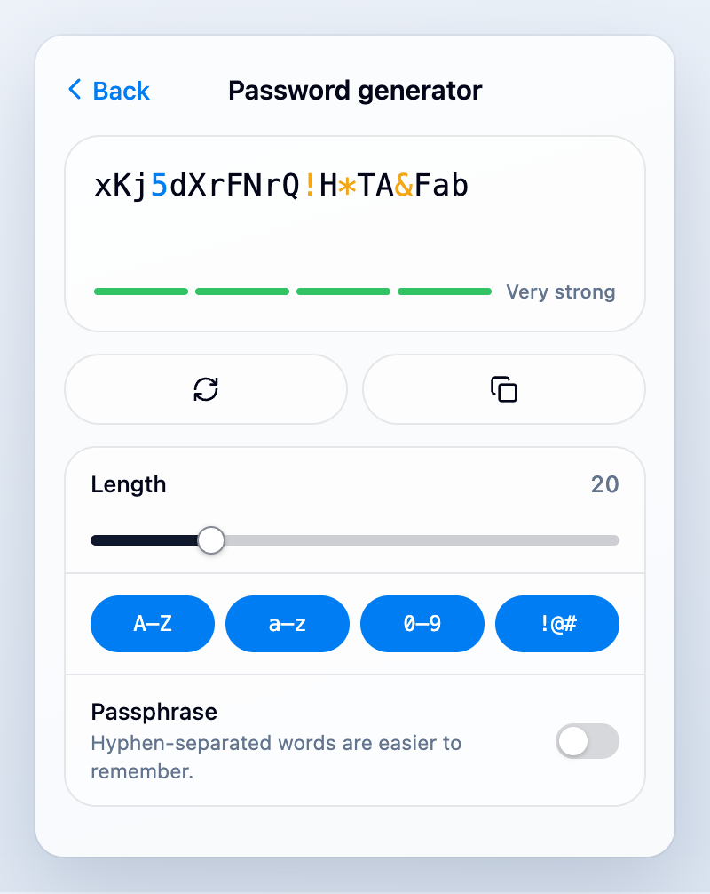
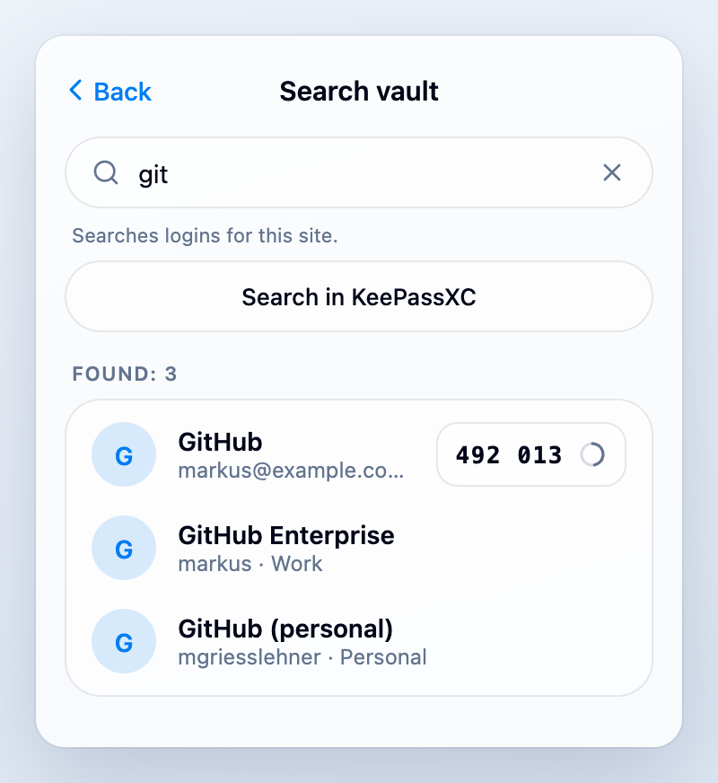
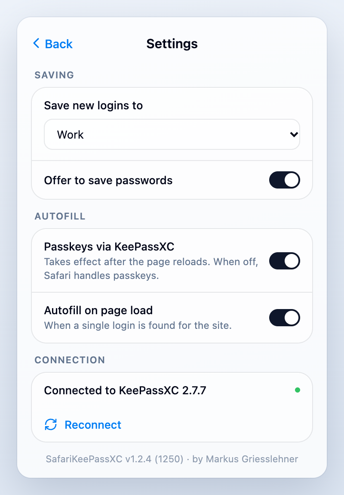

<p align="center">
  
</p>

<h1 align="center">SafariKeePassXC</h1>

<p align="center">
  A Safari Web Extension that connects Safari to your local <a href="https://keepassxc.org">KeePassXC</a> database.<br>
  Autofill logins, save new entries, use passkeys and generate passwords — with the same
  <a href="https://github.com/keepassxreboot/keepassxc-browser">KeePassXC-Browser protocol</a>
  the official Chrome and Firefox extensions use.
</p>

<p align="center">
  <a href="https://github.com/DrRamm/SafariKeePassXC/releases/latest"></a>
  
  
  <a href="https://github.com/DrRamm/SafariKeePassXC/stargazers"></a>
</p>

<p align="center">
  <a href="#install">Install</a> ·
  <a href="#features">Features</a> ·
  <a href="#how-it-works">How it works</a> ·
  <a href="#security">Security</a> ·
  <a href="#download">Download</a> ·
  <a href="#development">Development</a>
</p>

<p align="center">
  
</p>

Safari has no official KeePassXC integration. SafariKeePassXC fills that gap: it speaks the
KeePassXC-Browser protocol, so Safari can autofill, save and update logins, copy TOTP codes, use
passkeys and generate passwords — all backed by the local vault you already have.

## Install

1. **Download and install the app.** Get the latest `SafariKeePassXC-<version>.dmg` from
   [GitHub Releases](https://github.com/DrRamm/SafariKeePassXC/releases), open it, drag
   **SafariKeePassXC** to **Applications**, and launch it once. macOS verifies the signature and the
   notarization ticket.
2. **Open Safari** and go to **Safari → Settings → Extensions**.
3. **Enable SafariKeePassXC** in the list of extensions.
4. **Grant the access the extension needs** in its settings:
   - allow it in **all windows** — turn on **Allow in Private Browsing** if you use private browsing;
   - allow it on **all websites** so it can autofill logins everywhere.
5. **Restart Safari** — quit it completely and open it again, so the extension and its content
   scripts are loaded.
6. **Pair the extension with KeePassXC.** Open the popup from the Safari toolbar on any website,
   click **Pair**, and confirm the request in the KeePassXC window. The popup shows **Connected**
   when the pairing succeeded.

KeePassXC must be installed and running with browser integration enabled in
**Settings → Browser Integration** before pairing.

## Features

<table>
<tr>
<td width="33%" valign="top">

**Autofill for the current site**

The popup lists the logins that match the tab's domain. Pick one to fill the form, or let the
extension fill the first matching login automatically on page load.

</td>
<td width="33%" valign="top">

**Save and update logins**

When credentials are submitted, a banner offers to save them to KeePassXC or to update a changed
password — into the group you choose in the settings.

</td>
<td width="33%" valign="top">

**TOTP codes**

Entries with a one-time password show a live code with a countdown ring. Click it to copy the
current code to the clipboard.

</td>
</tr>
<tr>
<td width="33%" valign="top">

**Password generator**

Length, character sets and a passphrase mode, with a strength meter. The generated password is
shown in the popup and copied to the clipboard with one click.

</td>
<td width="33%" valign="top">

**Passkeys via KeePassXC**

WebAuthn requests are routed to KeePassXC. The RP ID is validated against the bundled Public
Suffix List, and the page-world shim only runs on HTTPS.

</td>
<td width="33%" valign="top">

**Search**

Filter the logins for the current page, or hand the query to KeePassXC's own search and auto-type
window.

</td>
</tr>
</table>

Open the popup from the Safari toolbar: pick a login, copy a TOTP code, or generate a password.

## Screenshots

<table>
<tr>
<td width="50%" align="center" valign="top">
  
  <br><sub><b>Logins for this site.</b> Pick an entry to fill the form; TOTP codes copy with one click.</sub>
</td>
<td width="50%" align="center" valign="top">
  
  <br><sub><b>Generator.</b> Length, character sets, passphrase mode and a strength meter.</sub>
</td>
</tr>
<tr>
<td width="50%" align="center" valign="top">
  
  <br><sub><b>Search.</b> Filter the logins for the page, with their groups.</sub>
</td>
<td width="50%" align="center" valign="top">
  
  <br><sub><b>Settings.</b> Save group, passkeys, autofill and the connection status.</sub>
</td>
</tr>
</table>

## How it works

KeePassXC exposes a local Unix domain socket that browser extensions connect to and encrypt
messages over using NaCl/libsodium public-key crypto — the same handshake the official
KeePassXC-Browser extension uses.

Safari Web Extensions run in a sandboxed app extension process and cannot reach that socket
directly. SafariKeePassXC bridges the gap with a small relay:

```text
Safari Extension (sandboxed)  <--Unix socket-->  Host App (BridgeServer)  <--Unix socket-->  KeePassXC
```

The host app is the only component that talks to KeePassXC. The extension reaches it through
`nativeMessaging` and a token-authenticated local socket.

## Security

SafariKeePassXC is a password manager bridge, so its security properties are documented
explicitly. The full model — permissions, content scripts, the native side, network access,
caveats and the supply chain — lives in [SECURITY.md](SECURITY.md).

- **Your vault stays local.** The extension makes no network requests. Passwords, TOTP secrets and
  passkeys are read from KeePassXC over a local Unix socket and are never uploaded anywhere.
- **Only KeePassXC can decrypt the traffic.** The host app speaks the KeePassXC-Browser protocol:
  X25519 key exchange plus `crypto_box` (XSalsa20-Poly1305) authenticated encryption.
- **Only the real extension can use the bridge.** The host app generates a fresh random 32-byte
  token on every launch, stores it in the shared Keychain access group, and rejects any connection
  that does not present it (compared in constant time).
- **The extension is sandboxed.** It cannot open files, spawn processes or reach the network. Its
  only way out is `nativeMessaging` to the containing app.
- **Autofill stays in the top frame.** `all_frames` is disabled for every content script, so
  embedded cross-origin iframes never receive credentials.
- **Releases are signed and notarized.** Every DMG carries a Developer ID signature and a stapled
  notarization ticket. See [Verifying a release](docs/RELEASING.md#verifying-a-release).

Found a vulnerability? Please report it privately — see [SECURITY.md](SECURITY.md).

## Requirements

- macOS 26.5 (Tahoe) or later, with the Safari version that ships with it
- [KeePassXC](https://keepassxc.org) installed, with browser integration enabled in
  **Settings → Browser Integration**
- Xcode 26 or later to build the app

## Download

- [GitHub Releases](https://github.com/DrRamm/SafariKeePassXC/releases) — signed and notarized DMGs

Every release DMG is signed with a Developer ID Application certificate, notarized by Apple and
stapled. See [Verifying a release](docs/RELEASING.md#verifying-a-release).

## Development

Open `SafariKeePassXC.xcodeproj` in Xcode, select your own Development Team in the signing
settings for both the `SafariKeePassXC` and `SafariKeePassXC Extension` targets, and run the
`SafariKeePassXC` scheme. Then enable the extension in Safari under **Settings → Extensions**.

The project has two test suites, both run by CI:

```bash
# JavaScript unit tests (popup generator/search, passkey adapters)
node --test tests/*.test.mjs

# Swift unit tests (crypto, bridge, sockets, passkey validation)
xcodebuild test \
  -project SafariKeePassXC.xcodeproj \
  -scheme SafariKeePassXC \
  -destination 'platform=macOS' \
  -only-testing:SafariKeePassXCTests \
  CODE_SIGNING_ALLOWED=NO
```

The Keychain-backed tests (`AssociationStore`, `BridgeToken.verify`) are skipped automatically when
the test host is not signed with a provisioning profile. Run them from Xcode with your team
selected to execute them.

`scripts/check-versions.sh` verifies that the app and extension `MARKETING_VERSION` values and the
extension manifest version all match.

Releases are fully automated by GitHub Actions: version checks, tests, Developer ID signing,
notarization and publishing. The process, the required repository secrets and the steps to verify
a download are in [docs/RELEASING.md](docs/RELEASING.md).

Contributions are welcome — see [CONTRIBUTING.md](CONTRIBUTING.md).

## License

SafariKeePassXC is licensed under the [GNU General Public License v3.0](LICENSE).

It depends on [Sodium](https://github.com/jedisct1/swift-sodium) (ISC License), a Swift wrapper
around [libsodium](https://libsodium.org), fetched as a Swift Package Manager dependency.
